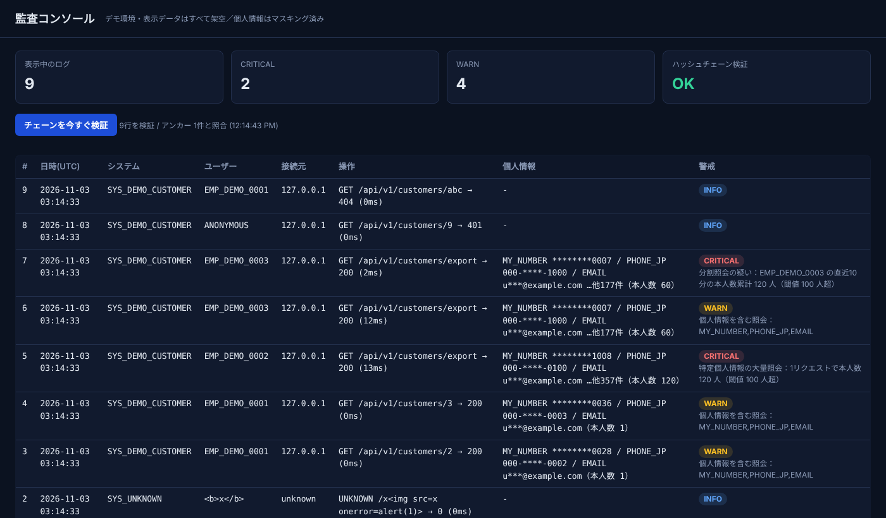
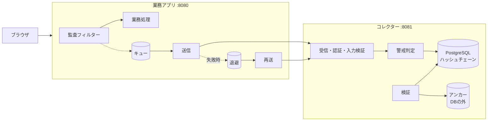
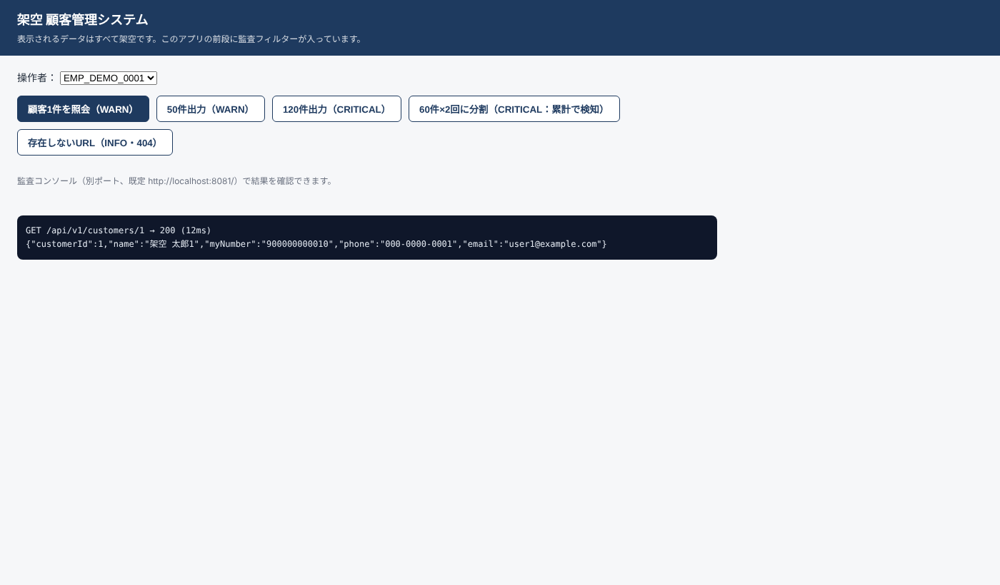

# Japan Audit Platform

**業務アプリを改修せずに、個人情報へのアクセスを記録・検知・改ざん検証する監査ログ基盤**（個人開発・学習用ポートフォリオ）

> 本リポジトリは個人学習・ポートフォリオ目的で独自に企画・設計・実装したものです（生成AI〈Claude Code〉を活用）。
> 登場する企業名・システムコード・氏名・番号はすべて架空のサンプルであり、実在の企業・人物とは関係ありません。
> 前職を含む実在の業務ソースコード・社内資料は使用していません。



## できること

| 機能 | 内容 |
|---|---|
| 非侵襲の収集 | 業務アプリの前段にフィルターを1つ挟むだけ。業務コードは監査を知らない。本文は1バイトも変えない |
| マスキング | マイナンバー（モジュラス11）・法人番号（モジュラス9）・電話・メール・基礎年金番号を検知し、生値を外に出さない |
| 6何の記録 | Who は認証結果だけ、Where は信頼済みプロキシ経由のときだけ X-Forwarded-For を採用（なりすまし防止） |
| 大量照会の検知 | 本人数（異なるマイナンバーの数）が100人**超**で CRITICAL。同一ユーザーの10分累計でも判定（分割照会対策） |
| フェイルオープン | コレクター停止中も業務は止めない。ローカルに退避し、復旧後に欠損なく再送（受信側で冪等） |
| 改ざん検証 | 受信順の SHA-256 ハッシュチェーン（直列化・WORM）。DB 内の検証に加え、DB の外のアンカーと照合 |

## 構成



| モジュール | 役割 |
|---|---|
| `audit-core-rule` | 検知・チェックディジット・マスキング |
| `audit-sensor` | フィルター・本文コピー・非同期送信・退避・再送 |
| `audit-collector-server` | 受信 API・警戒判定・DB 保存・検証・監査コンソール |
| `sample-business-app` | センサーを組み込んだ架空の顧客管理システム |
| `servlet-api-lite` | `jakarta.servlet` の最小サブセット（依存ゼロで動かすための自作スタブ） |

**技術**：Java 21（仮想スレッド・record・switch 式）／ JDK 標準の HttpServer・HttpClient ／ PostgreSQL 16（PL/pgSQL・pgcrypto、TimescaleDB は任意）／ Gradle ／ JUnit 5 ／ Docker Compose
フレームワークが隠している仕組み（本文の再読み込み、非同期送信、冪等性、認証）を理解するため、あえて依存ライブラリなしで実装しています。

## 動かし方

```bash
cp .env.example .env          # パスワードとキーを必ず変更する
docker compose up -d --build
```

| 画面 | URL |
|---|---|
| 架空の業務アプリ（ボタンで照会・大量出力などを実行） | http://localhost:8080/ |
| 監査コンソール（.env の CONSOLE_USER / CONSOLE_PASSWORD） | http://localhost:8081/ |



## 検証

```bash
./gradlew test                                   # 単体テスト（47件）
set -a; source .env; set +a
./scripts/e2e-verify.sh                          # E2E 検証（業務アプリ → コレクター → DB を実際に通す）
RUN_TAMPER=1 ./scripts/e2e-verify.sh             # 改ざん検知も試す（DB を書き換えるので後で docker compose down -v）
```

E2E 検証では次を確認します（結果は [検証手順書](docs/04_導入・受入テスト検証手順書.md)）。

1. 監査ログが届き、生のマイナンバーがコレクターのどこにも無い
2. 120人分の出力で CRITICAL、60人×2回の分割照会でも CRITICAL
3. 未認証アクセスも ANONYMOUS として記録
4. X-Forwarded-For・ユーザーヘッダーの偽装が採用されない
5. 200KB の本文が業務側に全部届く
6. 収集 API・コンソールの認証、XSS 対策（CSP）
7. コレクター停止中も業務は 200、復旧後に停止中のログが欠損なく届く
8. ハッシュチェーン検証、改ざん検知

## 設計ドキュメント

| 文書 | 内容 |
|---|---|
| [01 要件定義書](docs/01_要件定義書.md) | 目的・スコープ・関連法令・機能／非機能要件と受入基準 |
| [02 基本設計書](docs/02_基本設計書.md) | 構成・API・電文・テーブル・設定項目 |
| [03 詳細設計書](docs/03_詳細設計書.md) | クラス・シーケンス・判定ロジック・ハッシュチェーン・エラー処理 |
| [04 導入・受入テスト検証手順書](docs/04_導入・受入テスト検証手順書.md) | 導入手順・テスト一覧・実施結果 |
| [05 設計判断記録（ADR）](docs/05_アーキテクチャ設計判断・技術課題解決記録.md) | 判断理由とトレードオフ、自己レビューで見つけた欠陥と対応 |

## 限界と今後の課題

- 氏名・住所は形式で判定できないため検知しない（本文を送らない設計で補っている）。
- マイナンバーの判定はチェックディジット＋文脈。ランダムな12桁の約10%は検証を通るため、誤検知はゼロではない。
- 監査用にコピーする本文は先頭64KBまで。超えた部分の個人情報は数えられない。
- 分割照会の集計はコレクターのメモリ上（再起動で消える・複数台で共有しない）。
- ハッシュチェーンの書き込みは直列化されるため、大規模ではチャンク単位のハッシュ等に変える必要がある。アンカーは本番では別サーバー・WORM ストレージへ送る。
- Spring Boot の Starter 化（AutoConfiguration）、コネクションプール、mTLS は未対応。

## 関連法令について

警戒の閾値は、番号法 第29条の4・委員会規則第2条の報告基準（特定個人情報の本人の数が100人を超える事態）を参考にした**社内監視の目安**です。
個人情報保護法 第26条の人数基準は1,000人超です。本システムは法的判断を行いません。

## ライセンス

[MIT License](LICENSE)
