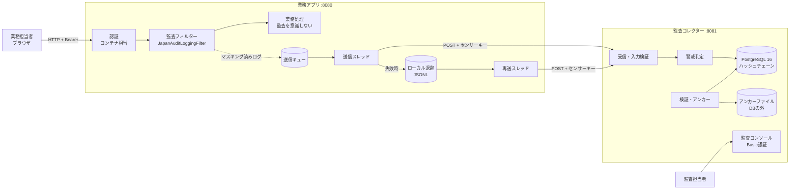

# 基本設計書

| 項目 | 内容 |
|---|---|
| システム名 | Japan Audit Platform |
| 文書番号 | JAP-BD-001 |

## 改版履歴

| 版数 | 日付 | 変更内容 |
|---|---|---|
| 1.0 | 2026-10 | 初版 |
| 2.0 | 2026-11-03 | 実装に合わせ全面改訂（モジュール構成、API、電文、テーブル、設定項目） |

---

## 1. システム構成

## 2. モジュール構成

| モジュール | 役割 | 依存 |
|---|---|---|
| `servlet-api-lite` | `jakarta.servlet` の最小サブセット（依存ゼロで動かすための学習用スタブ。同じパッケージ・シグネチャなので本物の API に差し替え可能な設計） | なし |
| `audit-core-rule` | 個人情報の検知・チェックディジット検証・マスキング | なし |
| `audit-sensor` | 監査フィルター、本文コピー用ラッパー、非同期送信、ローカル退避・再送 | core-rule, servlet-api-lite |
| `audit-collector-server` | 受信 API、警戒判定、DB 保存、チェーン検証、アンカー、監査コンソール | JDBC ドライバー（実行時のみ） |
| `sample-business-app` | センサーを組み込んだ架空の顧客管理システム（デモ） | audit-sensor |

## 3. 処理概要

| No | 処理 | 概要 |
|---|---|---|
| P-01 | 監査ログ生成 | フィルターが業務処理の前後で本文をコピー（上限付き）し、検知・マスキングしてログを作る |
| P-02 | 非同期送信 | キューに入れて即座に業務へ戻る。送信スレッドがコレクターへ POST |
| P-03 | 障害時退避 | 送信失敗・キュー満杯のときはローカルファイルへ退避。失敗後一定時間はコレクターを叩かない（サーキットブレーカー） |
| P-04 | 再送 | 一定間隔で退避ファイルを送り直す。成功分は削除、失敗したら残りを次回へ |
| P-05 | 受信・判定・保存 | 認証→入力検証→警戒判定→DB 保存（重複は無視）→分割照会の集計に反映 |
| P-06 | チェーン検証 | DB の検証関数と、DB の外に記録したアンカーの両方で照合 |

## 4. 外部インタフェース（コレクター API）

| メソッド | パス | 認証 | 応答 |
|---|---|---|---|
| POST | `/api/v1/collector/ingest` | `X-Audit-Sensor-Key` | 202 新規 / 200 重複（冪等）/ 400 入力不正 / 401 認証NG / 413 大きすぎ / 503 保存不可 |
| GET | `/api/v1/collector/logs?limit=n` | Basic | 直近ログ（JSON 配列、マスキング済み） |
| GET | `/api/v1/collector/chain/verify` | Basic | `{"status":"OK"/"BROKEN"/"UNAVAILABLE", "checkedRows", "anchors", "problems":[...]}` |
| POST | `/api/v1/collector/chain/anchor` | Basic | 現在の先頭をアンカーとして記録 |
| GET | `/api/v1/collector/health` | なし | `{"status":"UP"}` |
| GET | `/`、`/console.js` | Basic | 監査コンソール |

**503 を返す理由**：DB に書けなかったのに 2xx を返すと、センサーは「届いた」と判断して退避しないため、ログが失われる。

### 4.1 送信電文（センサー → コレクター、JSON 1件）

| 項目 | 型 | 必須 | 説明 |
|---|---|---|---|
| traceId | string(≤36) | ○ | ログ1件の ID（UUID）。冪等キー |
| timestamp | string | ○ | リクエスト開始時刻（ISO-8601、UTC） |
| systemCode | string(≤32) | | 業務システムの識別子 |
| hostName | string(≤64) | | 業務サーバー名 |
| clientIp | string(≤45) | | 接続元（信頼済みプロキシ経由のときだけ X-Forwarded-For） |
| userPrincipal | string(≤64) | | 認証済みユーザー。無ければ `ANONYMOUS` |
| httpMethod / requestUri / queryString | string | | 操作内容（クエリもマスキング済み） |
| httpStatus / executionTimeMs | number | | 結果と処理時間 |
| piiDetected / piiOccurrences | bool / number | | 個人情報の有無・出現回数 |
| myNumberPersonCount | number | | 異なるマイナンバーの数（≒本人数） |
| details[] | array | | `{piiType, maskedValue, occurredIn, confidence}` |
| requestBody / responseBody | string\|null | | 既定は null（データ最小化。`AUDIT_SEND_BODY=true` のときだけマスキング済み本文） |

## 5. テーブル一覧

| テーブル | 論理名 | 主な項目 |
|---|---|---|
| `t_audit_access_log` | アクセス監査ログ | chain_seq（受信順の連番）、trace_id、6何の項目、件数、alert_level / alert_reason、details_digest、prev_record_hash、record_hash |
| `t_audit_pii_detail` | 検知明細 | trace_id、seq_no、pii_type、masked_value（マスキング値のみ）、occurred_in、confidence |
| `t_audit_chain_head` | チェーン先頭 | last_seq、last_hash（1行のみ。挿入の直列化と末尾削除の検出に使う） |

| 関数・トリガー | 役割 |
|---|---|
| `fn_audit_before_insert` | 先頭行ロック → 重複なら無視 → 採番 → ハッシュ計算 → 先頭更新 |
| `fn_audit_reject_change` | UPDATE / DELETE / TRUNCATE を拒否（WORM） |
| `fn_audit_row_hash` / `fn_audit_details_digest` | ハッシュ計算式（挿入時と検証時で共通） |
| `fn_audit_verify_chain` | 問題のある行を返す（0行なら正常） |

## 6. 画面一覧

| 画面 | URL | 内容 |
|---|---|---|
| 業務アプリ操作画面 | `http://localhost:8080/` | 操作者を選び、照会・大量出力・分割照会などを実行（デモ用） |
| 監査コンソール | `http://localhost:8081/` | ログ一覧（3秒ごと更新）、件数、チェーン検証ボタン |

## 7. 設定項目（環境変数）

| 対象 | 変数 | 既定値 | 説明 |
|---|---|---|---|
| 共通 | `SENSOR_KEY` | （必須） | センサー認証キー。16文字以上 |
| コレクター | `DB_HOST` `DB_PORT` `DB_NAME` `DB_USER` `DB_PASSWORD` | localhost / 5432 / auditdb / audit_user / （必須） | DB 接続 |
| コレクター | `COLLECTOR_STORAGE` | postgres | `memory` にすると DB なしで動く（検証不可） |
| コレクター | `CONSOLE_USER` `CONSOLE_PASSWORD` | auditor / （必須） | コンソール認証。未設定ならコンソール無効 |
| コレクター | `ALERT_PERSON_THRESHOLD` `ALERT_WINDOW_MINUTES` | 100 / 10 | 警戒閾値（本人数・超）と累計の時間窓 |
| コレクター | `ANCHOR_FILE` `ANCHOR_INTERVAL_SECONDS` | ./data/chain-anchors.jsonl / 60 | アンカーの保存先と間隔 |
| センサー | `COLLECTOR_URL` `AUDIT_SYSTEM_CODE` | — | 送信先とシステム識別子 |
| センサー | `SPOOL_PATH` `AUDIT_MAX_SPOOL_BYTES` `AUDIT_RESEND_INTERVAL_MS` | tmp / 100MB / 5000 | 退避先・上限・再送間隔 |
| センサー | `AUDIT_MAX_CAPTURE_BYTES` `AUDIT_SEND_BODY` | 65536 / false | 監査用コピーの上限、本文送信の有無 |
| センサー | `AUDIT_TRUSTED_PROXIES` | （空） | X-Forwarded-For・ユーザーヘッダーを信用するプロキシの IP（カンマ区切り） |
