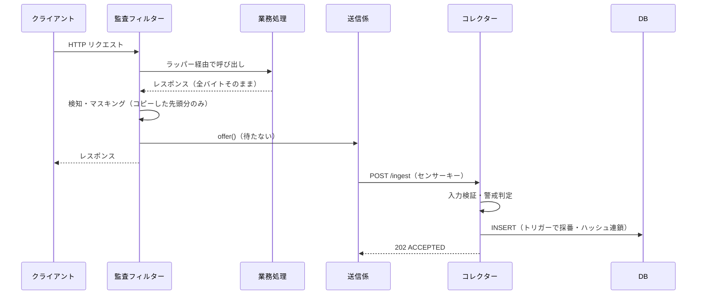
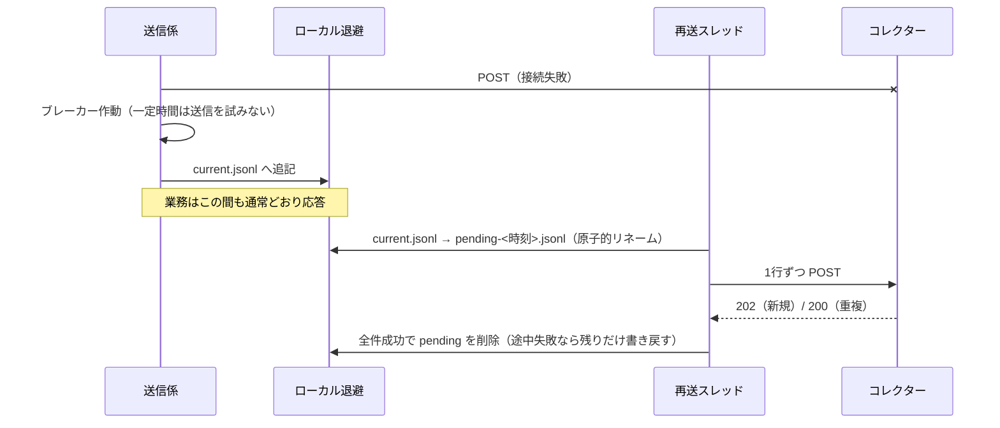

# 詳細設計書

| 項目 | 内容 |
|---|---|
| システム名 | Japan Audit Platform |
| 文書番号 | JAP-DD-001 |

## 改版履歴

| 版数 | 日付 | 変更内容 |
|---|---|---|
| 1.0 | 2026-10 | 初版 |
| 2.0 | 2026-11-03 | 実装に合わせ全面改訂（本文コピー方式、送信・退避・再送、警戒判定、ハッシュチェーンの直列化・検証・アンカー） |

---

## 1. クラス一覧

### 1.1 audit-core-rule

| クラス | 責務 |
|---|---|
| `JapanPiiDetector` | 候補抽出（正規表現）→ チェックディジット検証 → 文脈判定 → 重複区間の除去 → マスキング済みテキスト生成 |
| `MyNumberModulus11Validator` | マイナンバーの検査用数字（番号法施行令第8条） |
| `CorporateNumberValidator` | 法人番号の検査用数字（先頭1桁・モジュラス9） |
| `AuditMaskingService` | 種別ごとのマスキング規則 |
| `DetectedItem` / `DetectionResult` | 検知結果。`toString()` は生値を出さない |

### 1.2 audit-sensor

| クラス | 責務 |
|---|---|
| `JapanAuditLoggingFilter` | 業務の前後で監査ログを作り、送信係へ渡す。Who / Where の決定 |
| `AuditContentCachingRequestWrapper` | 業務側が読んだバイトを素通しし、先頭の上限分だけコピー（Read-Through） |
| `AuditContentCachingResponseWrapper` | クライアントへ全部流しつつ、先頭の上限分だけコピー（Tee） |
| `BoundedCapture` | 上限付きのコピー用バッファ |
| `AuditLogDispatcher` | 送信キュー・送信スレッド・再送スレッド・サーキットブレーカー |
| `AuditTransport` / `HttpCollectorTransport` | コレクターへの送信手段（テストで差し替え可能） |
| `DiskSpoolManager` | ローカル退避と再送（ファイルの回転・部分再送・上限） |
| `AuditSensorFactory` / `AuditSensorProperties` | 部品の組み立てと設定 |

### 1.3 audit-collector-server

| クラス | 責務 |
|---|---|
| `CollectorServer` | HTTP ルーティング、認証、レスポンスヘッダー（CSP 等） |
| `MiniJson` | 厳密な JSON 解析と安全な文字列化 |
| `IngestRequest` | 電文の型変換と入力検証 |
| `Credentials` | センサーキー・Basic 認証の照合（定数時間比較） |
| `AlertEvaluator` | 警戒判定（1リクエスト・時間窓累計） |
| `IngestionService` | 判定 → 保存 → 集計反映の流れ |
| `AuditStore` / `PostgresAuditStore` / `InMemoryAuditStore` | 保存先 |
| `DetailDigest` | 明細ダイジェスト（DB 関数と同じ式） |
| `ChainAnchorService` | アンカーの記録と照合 |

## 2. シーケンス

### 2.1 正常時

### 2.2 コレクター停止時と復旧後

## 3. 判定ロジック

### 3.1 個人情報の検知

1. **ファストパス**：数字も `@` も含まない文字列は即返却。
2. **候補抽出**：前後が数字・ハイフンでない 12桁（4-4-4 のハイフン任意）など。長い番号の一部は拾わない。
3. **検証**：マイナンバーはモジュラス11、法人番号はモジュラス9。基礎年金番号・電話・メールは形式のみ。
4. **文脈判定**：直前40文字に「マイナンバー / 個人番号 / myNumber / kojinBango」等があれば HIGH、なければ MEDIUM。
5. **重複区間**：開始位置順に並べ、重なる区間は先に登録した（優先度の高い）種別を残す。

> ランダムな12桁の約10%はモジュラス11を通る（単体テストで実測）。MEDIUM も安全側でマスキングする。

### 3.2 マスキング規則

| 種別 | 例 | 結果 |
|---|---|---|
| マイナンバー | 123456789018 | `********9018` |
| 法人番号 | 7000012050002 | `7***********2` |
| 基礎年金番号 | 1234-567890 | `****-**7890` |
| 電話番号 | 090-1234-5678 | `090-****-5678`（ハイフン位置を保持） |
| メール | taro@example.com | `t***@example.com` |

### 3.3 警戒判定

| 条件（上から順に評価） | レベル |
|---|---|
| 1リクエストの本人数（異なるマイナンバーの数）が閾値（100）**超** | CRITICAL |
| 同一ユーザーの直近10分の本人数累計＋今回が閾値**超** | CRITICAL（分割照会の疑い） |
| 個人情報を1件以上含む | WARN |
| それ以外 | INFO |

- 「超」なので 100人ちょうどは CRITICAL にならない（番号法の報告基準「100人を超える」に合わせた）。
- 累計への反映は **DB に新規登録できたときだけ** 行う（再送の重複を二重に数えない）。

### 3.4 Who / Where の決定

| 項目 | 採用順 |
|---|---|
| Who | ① `getUserPrincipal()`（認証結果）② 信頼済みプロキシから来た場合のみ `X-Authenticated-User` ③ `ANONYMOUS` |
| Where | 信頼済みプロキシから来た場合のみ `X-Forwarded-For` の先頭、それ以外は接続元アドレス |

リクエスト本文や任意のヘッダーの自己申告は採用しない（なりすまし防止）。

## 4. ハッシュチェーン

### 4.1 ハッシュ計算式
`record_hash = SHA-256( prev_record_hash ␟ chain_seq ␟ request_timestamp(UTC固定書式) ␟ trace_id ␟ … ␟ alert_level ␟ alert_reason ␟ details_digest ␟ 本文 )`

- 区切りは U+001F。NULL は `N`、値は `V`+値として、NULL と空文字を区別する。
- 時刻は UTC 固定の書式にする（セッションのタイムゾーン設定で結果が変わらないように）。
- 計算式は `fn_audit_row_hash` に一本化し、挿入時と検証時で同じものを使う。
- 明細は `details_digest` としてまとめて本体のハッシュに含める（明細の改ざんも検出）。Java の `DetailDigest` と DB の `fn_audit_details_digest` は同じ式。

### 4.2 挿入時の処理（トリガー）
1. `t_audit_chain_head` の1行を `FOR UPDATE` でロック → 並行する挿入が1件ずつに並ぶ（チェーンが分岐しない）。
2. 同じ trace_id が既にあれば `RETURN NULL`（挿入しない＝冪等）。ロック取得後に確認するので、同時に同じログが来ても1件だけ残る。
3. `chain_seq = last_seq + 1`、`prev_record_hash = last_hash`、`record_hash` を計算。
4. 先頭行を更新。トランザクションが失敗すれば先頭の更新も戻る。

> 以前の版は「時刻が直前の行」を探してロックなしで連結していたため、同時挿入で分岐した（40件同時で8か所）。
> また、再送で古い時刻のログが後から届くと順序が崩れる。現在は「受信順の連番」で連結する。

### 4.3 検出できる改ざん

| 改ざん | 検出方法 |
|---|---|
| 行の内容の書き換え | 再計算したハッシュと `record_hash` が不一致 |
| 明細の書き換え | `details_digest` が不一致 |
| 途中の行の削除 | `chain_seq` の欠番 / `prev_record_hash` の不一致 |
| 末尾の行の削除 | 先頭行（`t_audit_chain_head`）と最後の行が不一致 |
| トリガーを外して全行を再計算 | DB 内では検出不可 → **DB の外のアンカー**と照合して検出 |

通常の UPDATE / DELETE / TRUNCATE はトリガーで拒否する。

## 5. ローカル退避のファイル

| ファイル | 状態 |
|---|---|
| `current.jsonl` | 書き込み中（JSON 1行＝1件。マスキング済み） |
| `pending-<時刻>-<連番>.jsonl` | 再送待ち。再送開始時に current をリネームして作る |
| `pending-….jsonl.tmp` | 部分再送後の書き戻し用（原子的に置き換える） |

- 書き込みはロックで直列化し、複数スレッドの行が混ざらないようにする。
- 合計が上限（既定100MB）を超えたら新しいログは破棄し、件数を `dropped` として数える（ディスク溢れで業務サーバーを止めない）。

## 6. エラー処理

| 事象 | 業務への影響 | 監査側の動き |
|---|---|---|
| 検知処理で例外 | なし（握りつぶして警告ログ） | そのリクエストのログは送られない |
| 業務処理で例外 | 例外はそのまま上位へ | status=500 としてログを送る |
| コレクター停止・タイムアウト | なし | 退避 → 再送 |
| キュー満杯 | なし | 直接退避 |
| 退避の上限超過・ディスク書き込み失敗 | なし | 破棄して件数を記録 |
| DB 停止 | — | コレクターが 503 → センサーが退避・再送 |
| 電文不正 | — | 400（再送しても直らないため、送信元の修正が必要） |
